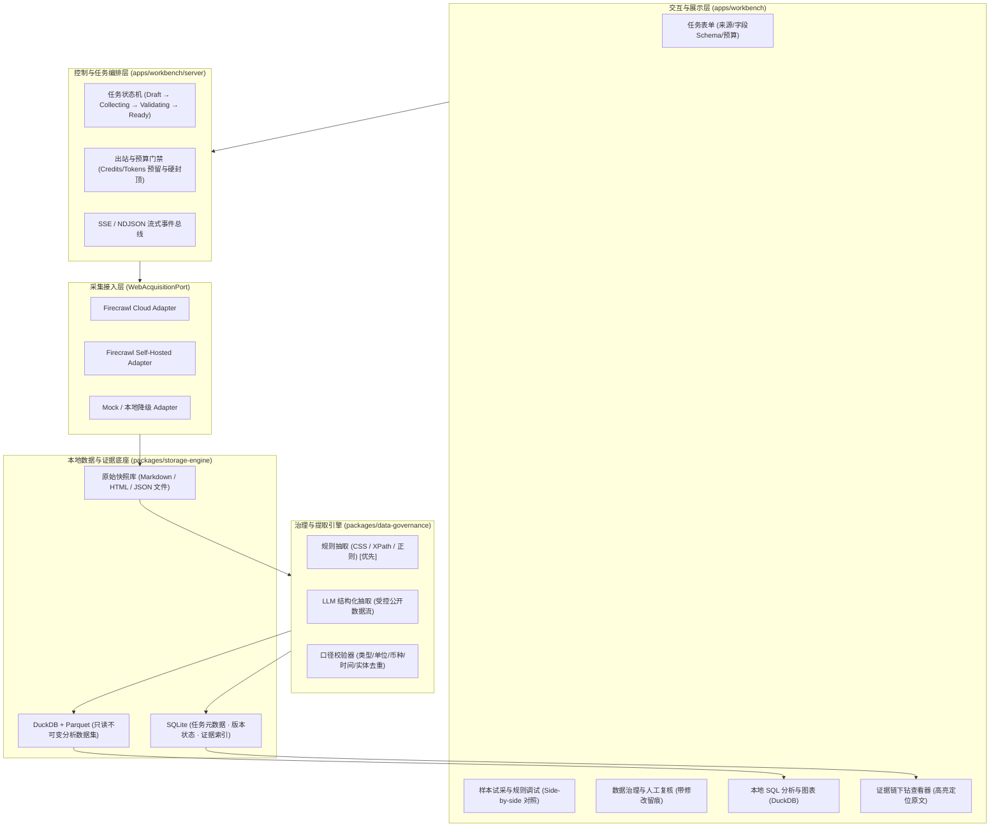

# Firecrawl 网页采集与本地数据分析平台产品方案

> **定位**：将获准采集的网页内容，转化为可验证、可追溯、可在本地分析的数据集资产。
> **演进形态**：优先作为本地独立工具运行和验收；成熟后，通过稳定数据与契约接口接入 JuanerAI / Xanthil、深度研究工作台、外部情报库及 Report Studio。

---

## 1. 核心产品愿景与设计哲学

传统“AI 爬虫”往往仅充当“抓取 HTML → 粗暴输入 LLM → 吐出无法核验的总结”，存在致命缺陷：幻觉污染决策、数据不可重算、私有敏感数据出站、无字段级证据链。

本项目致力于补齐**从公开网页到可信分析数据之间的完整工业级加工链路**：
```text
业务问题与采集范围
    → 来源发现与人工审批（Map / Search）
    → Firecrawl 适配层采集（Scrape / Crawl）
    → 本地原始快照保存（Raw Markdown / HTML / 哈希 / 时间留痕）
    → 字段结构化提取（规则优先，受控 LLM 兜底，人工复核）
    → 数据清洗与口径校验（类型 / 单位 / 币种 / 实体去重）
    → 冻结不可变分析数据集版本（Parquet + DuckDB）
    → 本地受控分析执行（预置 SQL / 分析模板）
    → 交付物与全链路证据包（指标 → 数据集版本 → 记录 → 字段证据 → 原始快照片段）
```

### 五项核心设计决策
1. **Firecrawl 负责取网页，本工具负责把内容变成分析资产**：底层采集引擎与上层数据治理、口径校验、本地计算、质量门禁严格解耦。
2. **独立运行优先**：系统默认以本地轻量架构运行，不预先捆绑复杂微服务或重型企业级系统。
3. **本地私有数据与外部模型/云端严格物理隔离**：本地业务数据（订单、库存等）绝对不进入 Firecrawl Cloud 或外部 LLM 上下文；公开网页的 LLM 抽取需单独显式授权。
4. **有限范围的严谨分析，不盲目追求无边界通用 Agent**：首期聚焦确定性字段提取、对比分析与证据交付，不盲目做全网无边界自主探索。
5. **把失败、缺失与不确定性作为正式业务结果**：页面无法抓取不能推断为对象不存在；字段缺失记录 `null` 并标明原因，严禁模型无据脑补。

---

## 2. 目标场景与交付边界

### 2.1 核心重点场景
| 场景 | 用户输入 | 工具产出 | 核心业务边界 |
|---|---|---|---|
| **公开商品与价格带对比**（首个验收样板） | 获准采集的品牌/商品 URL 列表、品类、币种、字段 Schema | 商品明细表、价格中位数/分布表、品牌对比、来源清单 | 标价不等于成交价；样本不等于全市场；口径分离 |
| **多网页通用字段采集** | URL 清单、字段提取 Schema、规则配置 | 规范化数据集、数据字典、逐字段证据索引 | 结构符合 JSON 不等于数值业务正确 |
| **外部公开信息与本地数据联表** | 外部采集数据集 + 本地私有 CSV/Excel | 关联分析报表、未匹配清单 | 私有明细数据禁止出站，关联不成功显式保留 |

### 2.2 首期交付范围与明确排除
- **交付**：URL 列表、站点发现（Map）、受限抓取、原始快照、规则/LLM 提取、质量复核界面、不可变 Parquet、DuckDB 本地计算、全链路证据包导出。
- **排除**：绕过验证码/登录墙/付费墙、账号密码模拟登录、全网无限制自动漫游、无沙箱防护的任意 Python 自动执行。

---

## 3. 总体系统架构设计

系统采用分层松耦合架构，从下至上分为五大核心层次：



---

## 4. 三层数据流与证据链体系

### 4.1 三层数据流隔离
1. **Raw Snapshot 层（原始快照）**：
   - 存储路径：`data/projects/<proj>/snapshots/<snapshot_id>/`
   - 保存内容：抓取获得的原始 Markdown、HTML、响应 HTTP 状态码、请求与抓取时间戳、SHA-256 内容哈希。
   - 规则：只追加、不可变。
2. **Normalized 层（规范化治理数据）**：
   - 经规则或模型清洗后的结构化记录，绑定口径类型、单位、置信度，并挂载 `FieldEvidence`（记录字段在原始快照中的定位）。
   - 用户人工复核修改必须填写理由，生成修订版本，不直接覆盖原始数据。
3. **Curated 层（分析数据集版本）**：
   - 存储格式：只读不可变 `data.parquet` + `schema.json` + `quality_report.json`。
   - 挂载至 DuckDB 视图，供本地 SQL 与分析模板高速查询。

### 4.2 证据链下钻闭环
每个报表关键数字和图表结论，必须具备完整追溯路径：
$$\text{分析结论/数字} \longrightarrow \text{AnalysisRun SQL} \longrightarrow \text{DatasetVersion} \longrightarrow \text{ExtractedRecord} \longrightarrow \text{FieldEvidence} \longrightarrow \text{SourceSnapshot 原文段落}$$

---

## 5. 存储分工与技术选型契约

| 组件 | 选用技术 | 核心职责 | 约束与防线 |
|---|---|---|---|
| **原始快照** | 本地文件系统 (磁盘) | 存储 Markdown、HTML、截图等原始载荷 | 计算 SHA-256 防篡改，避免大文件阻塞数据库 |
| **元数据与索引** | SQLite | 任务定义、运行状态、不可变版本清单、证据偏移索引 | 严格单进程写入或 WAL 模式，轻量可靠 |
| **分析执行引擎** | DuckDB + Parquet | 执行聚合统计、中位数计算、分组对比、本地多表连接 | 读写分离，分析端以只读模式挂载 Parquet，规避并发写锁 |
| **采集适配器** | Firecrawl Node SDK | 封装 Scrape / Crawl / Map / Search | 纯出站通道，由适配器统一规范化为统一快照格式 |
